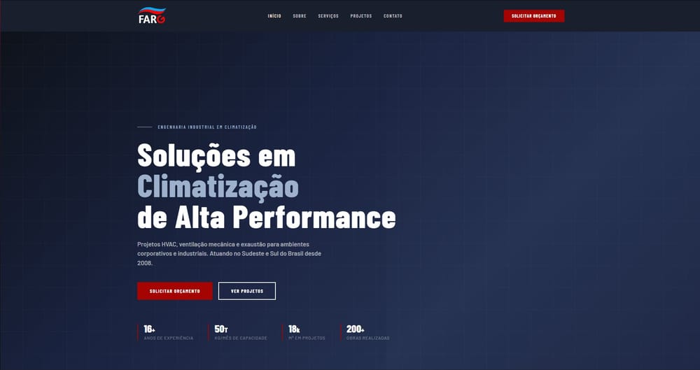

# Site FARG Ar-Condicionado

Site institucional da **FARG Ar-Condicionado**, empresa de engenharia em climatização, ventilação mecânica e exaustão que atua desde 2008. Projeto feito para cliente real, desenvolvido por mim através da agência NOFF Marketing.

**Site no ar:** https://fargarcondicionado.com



## Objetivo

Dar à FARG uma presença on-line profissional: apresentar a empresa, os serviços e as principais obras realizadas, e facilitar o contato de quem quer pedir um orçamento.

## Descrição

É uma SPA (Single Page Application) feita com Vue 3 e Vite, com cinco páginas:

| Rota        | Página    | Conteúdo                                                                  |
| ----------- | --------- | ------------------------------------------------------------------------- |
| `/`         | Início    | Apresentação, serviços, projetos em destaque, diferenciais e números      |
| `/sobre`    | Sobre     | História da empresa em linha do tempo, missão, visão e valores            |
| `/servicos` | Serviços  | Projetos HVAC, instalação e montagem, ventilação mecânica e exaustão      |
| `/projetos` | Projetos  | Portfólio de obras com filtro por categoria                               |
| `/contato`  | Contato   | Telefone, WhatsApp, e-mails, mapa e formulário de orçamento               |

Os textos e dados do site (contatos, serviços, projetos, linha do tempo) ficam separados dos componentes, em arquivos dentro de `src/data/`. Assim dá para atualizar o conteúdo sem mexer no layout.

## Principais funcionalidades

- Navegação entre páginas sem recarregar (Vue Router), com título da aba atualizado em cada rota e retorno ao topo ao trocar de página.
- Cabeçalho fixo que muda de estilo ao rolar a página e menu hambúrguer no celular.
- Layout responsivo para desktop, tablet e celular.
- Animação de entrada dos elementos ao rolar a tela (composable `useReveal`, com `IntersectionObserver`).
- Portfólio de projetos com filtro por categoria (Corporativo, Industrial, Financeiro); os projetos marcados com `featured: true` também aparecem na página inicial.
- Página de contato com links diretos para telefone, WhatsApp e e-mail, mapa do Google Maps incorporado e formulário de solicitação de orçamento.
- Links para o LinkedIn e o WhatsApp da empresa no rodapé.

> O formulário de orçamento é só front-end. Para que as mensagens cheguem à empresa, o envio precisa estar ligado a um serviço externo de formulário ou e-mail, configurado em `src/components/ContactForm.vue`.

## Tecnologias utilizadas

- [Vue 3](https://vuejs.org/) com Composition API (`<script setup>`)
- [Vue Router 4](https://router.vuejs.org/) (modo history)
- [Vite 5](https://vitejs.dev/) com `@vitejs/plugin-vue`
- CSS com estilos por componente (`scoped`) e variáveis CSS globais para cores, fontes e espaçamentos
- Google Fonts (Barlow e Barlow Condensed)

Não há back-end nem banco de dados: o build gera apenas arquivos estáticos.

## Como executar

Pré-requisitos: [Node.js](https://nodejs.org/) 18 ou superior e npm.

```bash
git clone https://github.com/Patokaz/farg-project.git
cd farg-project
npm install
npm run dev
```

Depois, abra http://localhost:5173 no navegador.

| Comando           | O que faz                                          |
| ----------------- | -------------------------------------------------- |
| `npm run dev`     | Servidor de desenvolvimento com recarga automática |
| `npm run build`   | Gera a versão de produção na pasta `dist/`         |
| `npm run preview` | Serve localmente o conteúdo de `dist/` para teste  |

## Deploy

O site em produção fica em hospedagem compartilhada com servidor Apache/LiteSpeed. Para publicar:

1. Rode `npm run build`.
2. Envie o conteúdo da pasta `dist/` para a pasta pública do domínio (normalmente `public_html`).
3. Garanta que exista um `.htaccess` na mesma pasta com a regra abaixo.

Como o Vue Router usa o modo history, rotas como `/projetos` só existem no navegador. Sem essa regra, abrir um link direto ou atualizar a página numa rota interna devolve erro 404, porque o servidor procura um arquivo que não existe:

```apache
<IfModule mod_rewrite.c>
  RewriteEngine On
  RewriteBase /
  RewriteRule ^index\.html$ - [L]
  RewriteCond %{REQUEST_FILENAME} !-f
  RewriteCond %{REQUEST_FILENAME} !-d
  RewriteRule . /index.html [L]
</IfModule>
```

Dica: salvando esse arquivo como `public/.htaccess`, o Vite o copia para `dist/` em todo build. Em outras hospedagens (Netlify, Vercel etc.) é preciso configurar uma regra equivalente de redirecionamento para o `index.html`.

## Estrutura do projeto

```
farg-project/
├── public/images/        # Logos e fotos (projetos/, servicos/, páginas)
├── src/
│   ├── assets/css/
│   │   └── global.css    # Variáveis de cor, fontes, reset e classes utilitárias
│   ├── components/       # Header, footer, hero, cards, formulário, banners etc.
│   ├── composables/
│   │   └── useReveal.js  # Animação de entrada ao rolar a página
│   ├── data/             # Conteúdo do site
│   │   ├── company.js    # Contatos, números, linha do tempo, valores, diferenciais
│   │   ├── services.js   # Serviços e benefícios
│   │   ├── projects.js   # Projetos e categorias do filtro
│   │   └── icons.js      # Ícones SVG
│   ├── layouts/
│   │   └── DefaultLayout.vue  # Header + conteúdo da página + footer
│   ├── pages/            # Uma página por rota
│   ├── router/index.js   # Rotas e títulos das abas
│   ├── App.vue
│   └── main.js
├── index.html
├── vite.config.js        # Plugin do Vue e alias "@" para src/
└── package.json
```

## Como atualizar o conteúdo

| Quero alterar...                          | Arquivo                                     |
| ----------------------------------------- | ------------------------------------------- |
| Telefone, WhatsApp, e-mails, endereço     | `src/data/company.js`                       |
| Números, linha do tempo, missão e valores | `src/data/company.js`                       |
| Textos e imagens dos serviços             | `src/data/services.js`                      |
| Projetos do portfólio                     | `src/data/projects.js`                      |
| Cores e fontes do site                    | `src/assets/css/global.css` (bloco `:root`) |

As imagens ficam em `public/images/` e são referenciadas a partir da raiz, por exemplo `/images/projetos/projeto-cielo.jpg`. Exemplo de projeto em `src/data/projects.js`:

```js
{
  id: 'cielo',
  client: 'Cielo',
  location: 'Barueri, SP',
  title: 'Cielo Barueri',
  category: 'corporativo',   // corporativo | industrial | financeiro
  featured: true,            // true = também aparece na página inicial
  desc: 'Descrição da obra...',
  image: '/images/projetos/projeto-cielo.jpg', // opcional; sem imagem, o card mostra um placeholder
}
```

## Autoria

Desenvolvido por **Raphael Gimenes** ([@Patokaz](https://github.com/Patokaz)) pela [NOFF Marketing](https://noffmarketing.com.br), para a FARG Ar-Condicionado.

Textos, logotipos e fotos de obras pertencem à FARG Ar-Condicionado. O código está aqui como portfólio e o conteúdo da marca não deve ser reutilizado.
